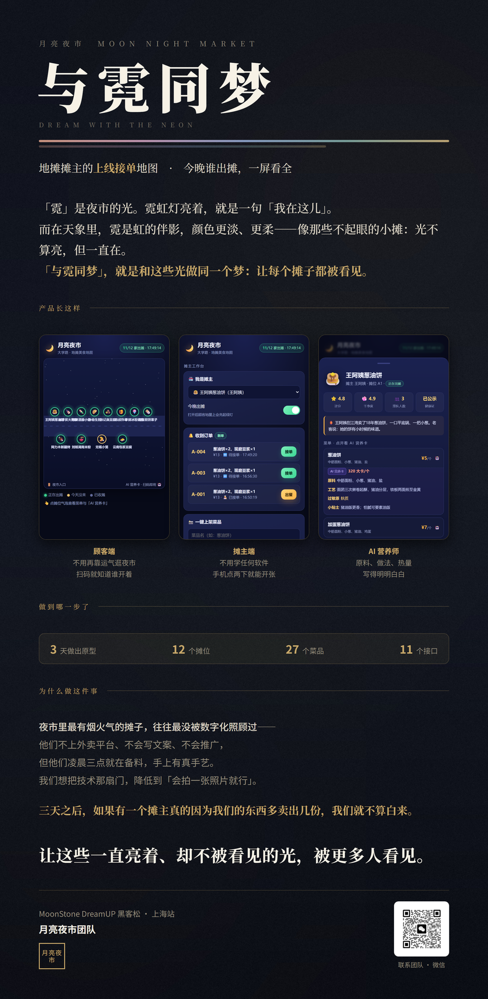

# 🌙 月亮夜市 Moon Night Market

> 地摊经济版美食地图 · 黑客松原型 v0.1
> 主题：**去月亮上捡块石头** —— 城市夜空里，每个小摊都是一块不起眼的石头，我们去把它们捡起来、点亮。

**与霓同梦 · 第三代产品** ｜ 让夜市小摊「上线接单」的地图应用：摊主拍一张照片就能上架，一个字都不用写。
*（与霓同梦 · 五代产品线：① 情绪烘焙坊 ② 手势交互系列 ③ **月亮夜市** ④ 全息 AI 开发辅助机器人 ⑤ 霓虹系列机器人集群）*



## 🚀 三步跑起来

```bash
# 1) 装依赖
pip install -r requirements.txt

# 2) （可选）配一个 DeepSeek API Key —— 不配也能跑，AI 问答会自动降级为规则回答
#    Windows:   set DEEPSEEK_API_KEY=sk-xxxx
#    Mac/Linux: export DEEPSEEK_API_KEY=sk-xxxx

# 3) 启动
python app.py
```

打开 **http://127.0.0.1:8790** 就能看到夜市地图。

**手机访问**：电脑和手机连**同一个 WiFi**，用电脑的内网 IP 打开，例如 `http://192.168.1.100:8790`
（Windows 查 IP：命令行 `ipconfig`，看「IPv4 地址」；Mac：`ipconfig getifaddr en0`）

> 仓库里带了 `moon.db`，里面是 **12 个虚构摊位**的种子数据，所以第一次跑就有内容；把它删掉重跑会自动重建。

## 📁 结构

```
月亮夜市/
├── app.py               FastAPI 后端 + 12 个摊位种子数据 + AI 接口
├── static/index.html    手机端界面（地图 / 摊位 / 商家 / AI 四个 Tab）
├── static/map/          手绘街区底图
├── moon.db              SQLite（虚构种子数据；删掉会自动重建）
├── docs/                界面预览与海报
├── requirements.txt     依赖
├── .env.example         环境变量示例
└── LICENSE              MIT
```

## ✅ 已实现功能

### 消费者端
- 🗺 **夜市地图**：Canvas 手绘街区，摊位气泡按状态发光（绿=出摊 / 黄=没来 / 灰=收摊）
- 🏮 **摊位列表**：招牌、评分、干净度、排队人数、健康证公示
- 🤖 **AI 营养卡**（点开每道菜）：原料 / 工艺 / 热量 / ⚠️过敏原 / 小贴士
- 🛒 **下单**：选择数量 → 生成取餐码（如 A-001）→ 实时状态流转（已下单 → 已接单 → 出餐）

### 商家端（摊主工作台）
- 🔘 **出摊开关**：一键切换，顾客地图立刻亮灯/熄灭
- 🔔 **接单**：订单列表 + 一键接单 / 出餐
- 📸 **一键上架菜品**：名称/价格/热量/原料/做法/过敏原

### AI 能力
- 🍢 **拍图识别小吃**（演示版=颜色特征匹配，正式版接多模态大模型）
- 💬 **AI 营养师问答**：已接入 **DeepSeek 真实大模型**，可问过敏、热量、慢性病忌口、推荐搭配
- 📊 夜市数据看板接口 `/api/stats`（订单数、GMV、最热摊位）

## 🎬 3 分钟演示脚本

1. **开场**：评委扫码 → 手机打开夜市地图
2. **找摊**：点「🥞 王阿姨葱油饼」→ 展开菜单 → 点开「AI 营养卡」：原料、做法、320 大卡、⚠️含麸质
3. **下单**：选 2 个葱油饼 → 下单 → 取餐码 A-001 弹出
4. **切商家端**：王阿姨的工作台 → 🔔 新单闪烁 → 接单 → 出餐（顾客端状态同步变化）
5. **AI 彩蛋**：AI Tab → 拍照识别小吃 → 或问 AI 营养师「我花生过敏能吃什么」
6. **收尾**："这就是从 Demo 被真人使用的最后一步。"

---

## 🔧 本地运行（队友版）

```bash
# 1) 装依赖
pip install fastapi uvicorn python-multipart httpx

# 2) 配 API Key（可选——不配也能跑，AI 问答会自动降级为规则回答）
#    Windows:   set DEEPSEEK_API_KEY=sk-xxxx
#    Mac/Linux: export DEEPSEEK_API_KEY=sk-xxxx

# 3) 启动
python app.py
# 打开 http://127.0.0.1:8790
```

**手机访问**：需要电脑和手机在**同一个 WiFi**，用电脑内网 IP 访问（如 `http://192.168.5.9:8790`）。
IP 变了的话，重新生成二维码即可（或者直接用 IP 手输）。

**代码里没有硬编码密钥** —— `_deepseek_key()` 优先读环境变量 `DEEPSEEK_API_KEY`，其次读本机 hermes 配置，都没有就降级为规则回答（演示仍可用）。

## 🔌 API 一览

| 方法 | 路径 | 说明 |
|---|---|---|
| GET | /api/stalls | 摊位列表（含状态/位置/菜品） |
| GET | /api/stalls/{id} | 摊位详情（含完整 AI 营养卡） |
| POST | /api/stalls/{id}/status | 摊主出摊/收摊 |
| POST | /api/stalls/{id}/items | 摊主上架菜品 |
| POST | /api/orders | 顾客下单 |
| GET | /api/orders?stall_id= | 商家订单列表 |
| POST | /api/orders/{id}/status | 接单/出餐 |
| POST | /api/recognize | 拍图识别小吃 |
| POST | /api/ask | AI 营养师问答（DeepSeek） |
| GET | /api/stats | 夜市数据看板 |

## ⚠️ 演示注意

- 演示数据是**虚拟的**（12 个摊位），但形态按真实上海夜市设计；路演时主动说明"这是 MVP 数据"
- 下单后**到摊自取 + 现场付款**，不接支付（绕开合规）
- 商家端演示时记得选对摊位（下拉框切换）

## 🛠 下一步可做

- 📸 **拍照即上架**（多模态）：摊主拍一张照 → 自动生成菜品信息（当前是表单，接口已预留）
- 🎤 **方言语音发布**：说一句话自动上架（数字包容）
- ⏰ **出摊预约/蹲摊提醒**：想吃但没出摊 → 出摊时通知
- 🏆 **打卡集章寻宝** + 排行榜
- 🌏 **多语言菜单翻译**（外国游客）
- 📊 **摊主备料建议**：基于销量预测


---

## 🌐 公网分享（可选，给不在同一网络的朋友）

朋友用流量也能打开，靠的是 **Cloudflare 快速隧道**（免费、不用注册）：本机服务 → 隧道 → 一个临时公网地址。

- 地址是**临时域名，每次隧道重启都会变**；
- **谁拿到链接都能打开**（夜市没有登录），只发给你想给的人；
- 依赖发起分享的那台电脑**开机 + 联网**，关机/休眠即断。

> 实现这套分享的脚本与本机的 `cloudflared.exe`（约 55MB）没有随仓库提供，需要的同学自行下载 [cloudflared](https://github.com/cloudflare/cloudflared/releases) 放在 `tools/` 下即可。
> `.gitignore` 已挡住 `tools/*.exe`、临时公网地址与二维码——**这些永远不要传上来**。

---

## 📄 许可

本项目使用 **MIT License** —— 你可以自由使用、修改、分发（包括商用），只需保留版权声明。见 [LICENSE](LICENSE)。

## 🙏 第三方资源

| 用到 | 许可 / 说明 |
|---|---|
| FastAPI / Uvicorn / httpx / Pillow | MIT / BSD 系开源许可 |
| DeepSeek API | 需自备 Key；不配则自动降级为规则回答 |
| 手绘街区底图、海报、图标 | 本项目自制 |
| 摊位与菜品的全部数据 | **纯虚构**，形态参考上海夜市，不对应任何真实商户 |

## 👥 关于与霓同梦

我们做的是让那些**不亮、却一直在的光**被看见的事——用技术去照顾那些没被照顾到的人。
霓如果只有一盏，那不叫霓虹。
**蝴蝶飞过霓虹，我们缺几个同梦的人。**
（有想法、想一起做，写信到 2954608699@qq.com ／ 2636480069@qq.com）

---

与霓同梦
你在，霓就亮。
